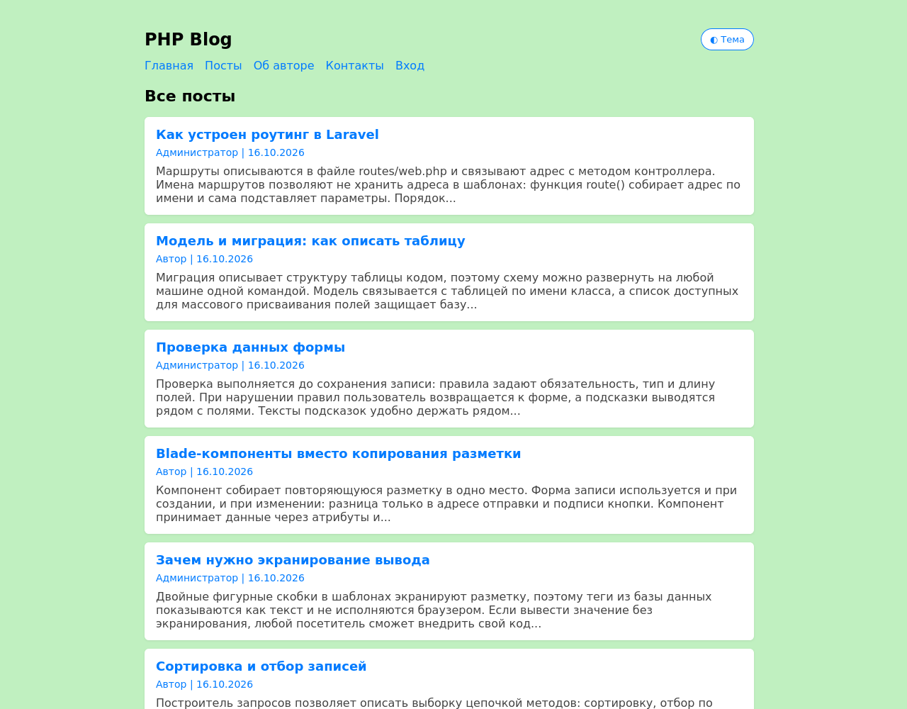
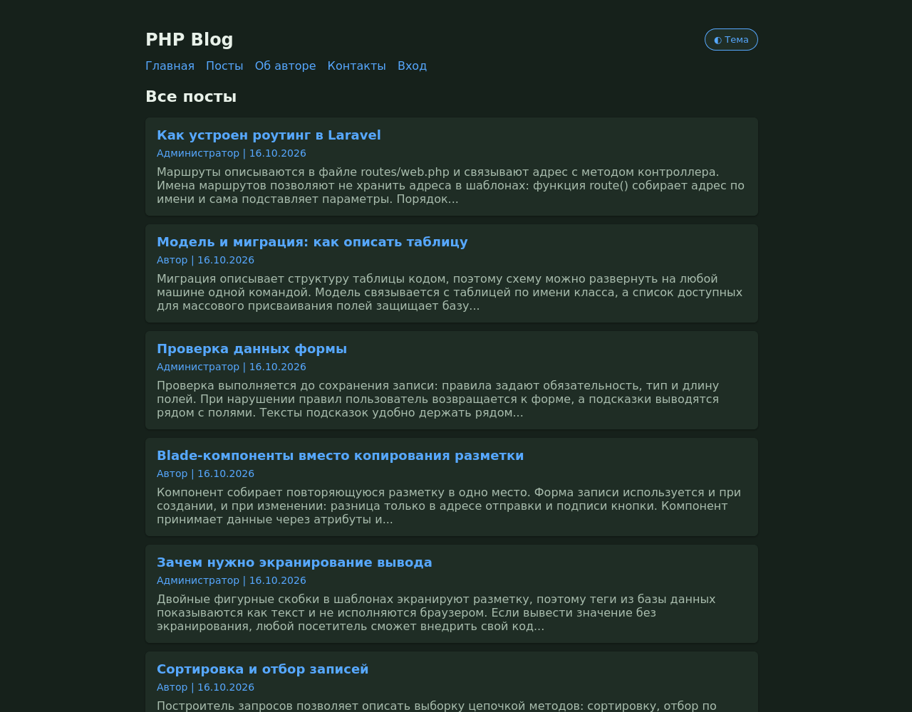
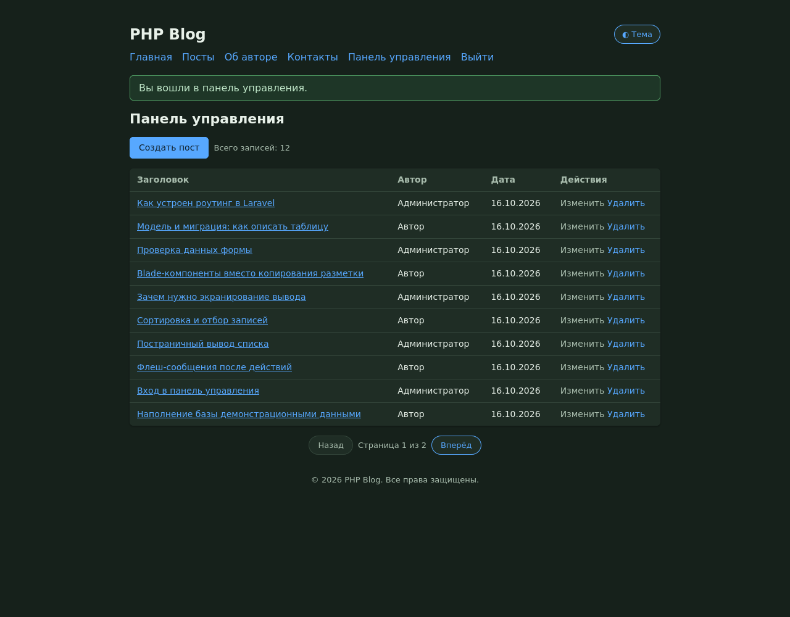
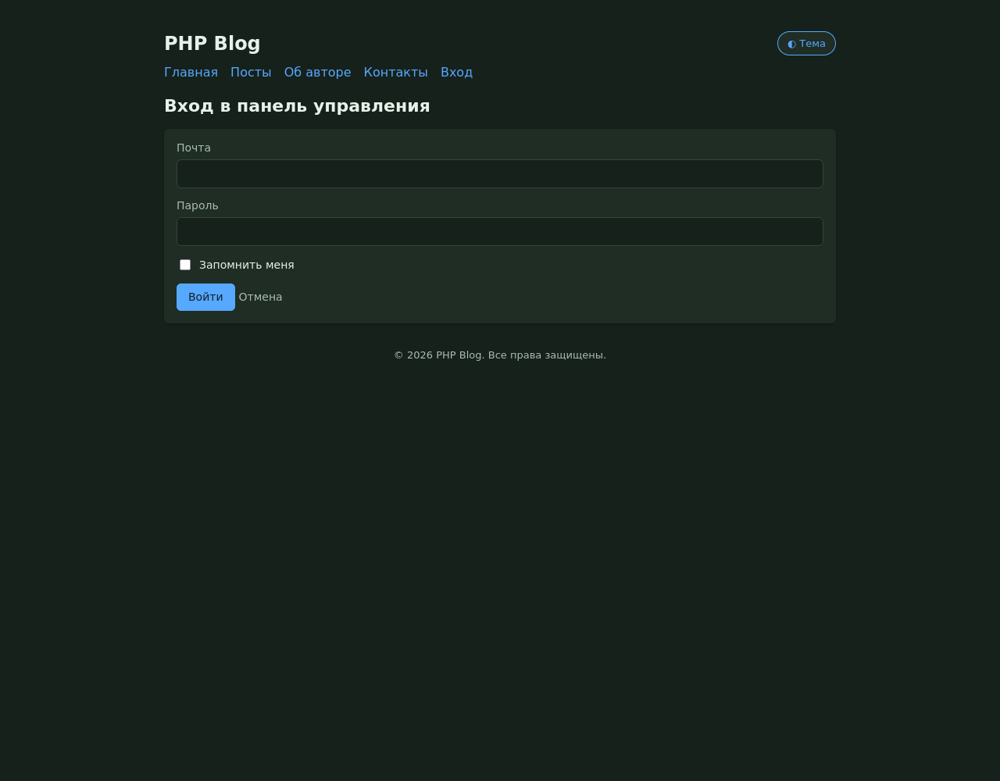
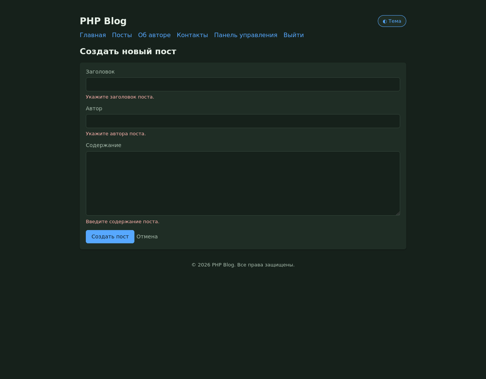
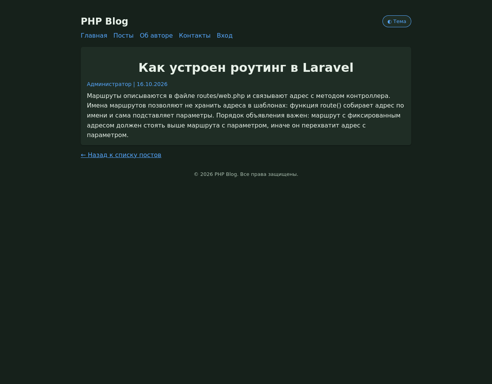
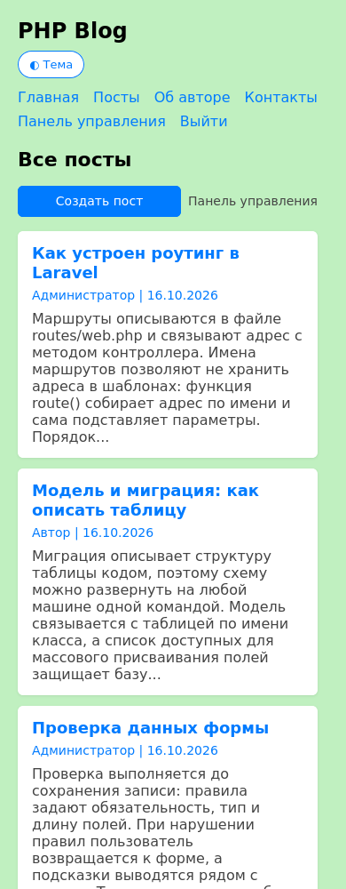

# PHP Blog

Блог на Laravel: записи хранятся в SQLite, читаются через Eloquent, страницы собираются
шаблонами Blade. Чтение открыто, ведение записей - после входа в панель управления.
Есть светлая и тёмная тема.



## Что умеет

| Действие | Адрес | Доступ |
| --- | --- | --- |
| Список постов | `GET /posts` | всем, по десять записей на страницу |
| Просмотр записи | `GET /posts/{id}` | всем |
| Главная, об авторе, контакты | `GET /`, `GET /about`, `GET /contacts` | всем |
| Вход, выход | `GET /login`, `POST /login`, `POST /logout` | всем |
| Панель управления | `GET /admin` | после входа |
| Создание записи | `GET /posts/create`, `POST /posts` | после входа |
| Изменение записи | `GET /posts/{post}/edit`, `PUT /posts/{post}` | после входа |
| Удаление записи | `DELETE /posts/{post}` | после входа |

| Тёмная тема | Панель управления |
| --- | --- |
|  |  |

| Вход в панель | Подсказки об ошибках |
| --- | --- |
|  |  |

| Просмотр записи | Узкий экран |
| --- | --- |
|  |  |

## Стек

| Слой | Технологии |
| --- | --- |
| Язык и фреймворк | PHP 8.3 или новее, Laravel 13 |
| База данных | SQLite, миграции и наполнение через Artisan |
| Работа с данными | Eloquent ORM, массовое присваивание ограничено списком полей |
| Доступ | сеансовая проверка входа средствами фреймворка, без дополнительных пакетов |
| Шаблоны | Blade: общий макет, компонент формы, экранирование вывода |
| Стили и темы | один файл `public/css/blog.css`, переключение темы на стороне браузера |
| Тесты | PHPUnit через `php artisan test` |

Сборка ресурсов не нужна: стили лежат готовым файлом, поэтому `npm` в проекте не
требуется.

## Устройство

```
php-blog/
├── app/
│   ├── Http/Controllers/
│   │   ├── LoginController.php    # вход в панель управления и выход
│   │   ├── PageController.php     # главная, об авторе, контакты
│   │   └── PostController.php     # список, просмотр, панель, создание, изменение, удаление
│   ├── Models/Post.php            # модель записи блога
│   └── View/Components/PostForm.php
├── database/
│   ├── migrations/                # таблицы блога, пользователей, кеша, очередей
│   └── seeders/                   # двенадцать записей и демонстрационная учётная запись
├── public/css/blog.css            # стили, светлая и тёмная тема
├── resources/views/               # макет, страницы, формы, ссылки постраничного вывода
├── routes/web.php                 # маршруты блога
└── tests/                         # проверки страниц, доступа, форм и модели
```

Правила проверки полей вынесены одной константой и используются и при создании, и при
изменении записи. Тексты подсказок заданы рядом с правилами, поэтому интерфейс остаётся
русским независимо от языковых файлов фреймворка. Ведение записей закрыто middleware
проверки входа, чтение остаётся открытым.

## Быстрый старт

Нужен PHP 8.3 или новее с расширениями `mbstring`, `dom`, `curl`, `pdo_sqlite`.

```bash
composer install
cp .env.example .env
php artisan key:generate
php artisan migrate --seed
php artisan serve
```

Блог откроется на `http://localhost:8000`.

Демонстрационная учётная запись создаётся наполнением: почта `admin@example.com`,
пароль `password`. Перед рабочим запуском пароль нужно заменить, а демонстрационные
записи удалить.

## Данные

Таблица `posts`:

| Поле | Тип | Назначение |
| --- | --- | --- |
| `id` | целое, ключ | идентификатор записи |
| `title` | строка | заголовок |
| `content` | текст | содержание |
| `author` | строка | автор записи |
| `created_at`, `updated_at` | отметки времени | когда запись создана и изменена |

Проверка полей формы:

| Поле | Правила | Подсказка |
| --- | --- | --- |
| `title` | обязательно, текст, от 3 до 255 символов | «Заголовок короче трёх символов.» |
| `content` | обязательно, текст, от 10 символов | «Содержание короче десяти символов.» |
| `author` | обязательно, текст, от 2 до 100 символов | «Имя автора короче двух символов.» |

Наполнение базы: `php artisan migrate:fresh --seed` создаёт двенадцать записей и
учётную запись администратора. Отдельно `php artisan db:seed --class=PostSeeder`
добавляет только записи блога.

## Тесты

```bash
php artisan test
```

Тридцать семь проверок: список записей, порядок сортировки и постраничный вывод,
сообщение при пустой базе, страница записи, коды 404, экранирование разметки,
доступность статических страниц, вход с верными и неверными данными, выход,
запрет ведения записей без входа, показ кнопок после входа, форма создания и её поля,
сохранение записи, обязательность и длина полей, отбрасывание посторонних полей,
форма изменения и сохранение правок, удаление записи, тексты подсказок.

Вёрстка проверена в браузере на ширине 1280 и 390 пикселей: пятьдесят проверок
на список с постраничным выводом, страницу записи, панель управления, формы, подсказки
об ошибках, обе темы и отсутствие горизонтальной прокрутки.

## Развёртывание

```bash
php artisan optimize        # кеш конфигурации, маршрутов и шаблонов
php artisan optimize:clear  # сброс кеша
```

Кеш собирается для готового окружения: после правки `routes/web.php` или `config/*.php`
его нужно пересобирать. Настройки окружения описаны в `.env.example`: имя приложения,
соединение с SQLite, драйверы сессий, кеша и очередей, уровень журналирования.

## Ограничения

Регистрации нет: учётная запись создаётся наполнением, многопользовательского
разделения прав нет. Список выводится только по дате создания, поиска и отбора по
разделам нет. Изображения и вложения не поддерживаются, комментариев нет. Тема
запоминается в браузере отдельно для каждого устройства.

## Лицензия

MIT, см. `LICENSE`.
